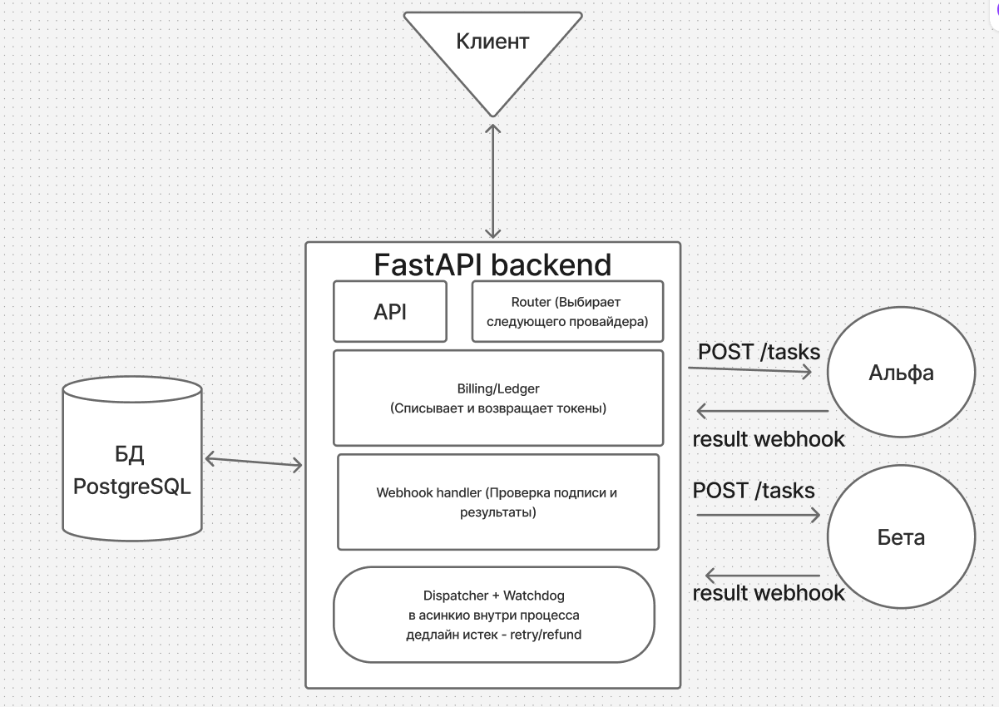

# Generation Service

Сервис генерации картинок и видео. Принимает запрос, списывает tokens, раскидывает
задачу по провайдерам alpha/beta, ловит их webhookи а если провайдер
затупил — добивает attempt через watchdog и делает refund.

Стек: FastAPI + PostgreSQL + SQLAlchemy (async) + Alembic. Тесты — `pytest`,
без моков: ходят в живой сервис, живую базу и фейковые провайдеры.

Сервис разрабатывался с использованием ИИ в качестве вспомогательного инструмента. Основную бизнес-логику и реализацию сервиса я написал самостоятельно. ИИ использовал для генерации тестов, Makefile и миграций базы данных. Архитектурные решения и логику работы сервиса прорабатывал сам.

---

как сделан ровно один раз

баланса отдельного нет только ледже (append-only) и баланс это сумма записей. на idempotency_key стоит UNIQUE и вставка идёт через ON CONFLICT DO NOTHING. ключи такие payment:id charge:task_id refund:task_id. кто первый вставил тот и поменял баланс остальные ничего не делают. списание и задача идут в одном транзакшне с локом юзера (FOR UPDATE) так что в минус не уйти. возврат только в одном месте и в одной транзакции со сменой статуса на failed плюс условный UPDATE попытки WHERE status=running поэтому из 10 отказов refund один

---

падение посреди вебхука

всё делается одной транзакцией и 202 отдаём после коммита. упали до коммита то ничего не поменялось и повтор безопасен. упали после коммита то ретрай увидит дубль и ничего не начислит второй раз. если задача зависла то вотчдог по таймауту закроет попытку и сделает либо следующую ногу либо refund. состояние всё в постгресе так что после рестарта ничего не теряется. может потеряться результат но не деньги

---

правило 6

если пришёл completed после того как вотчдог уже сделал failed то задача лочится и видит что она уже терминальная и просто выходит. условный UPDATE попытки тоже заденет 0 строк. отвечаем 202 ignored и ничего не пишем в result_url и ледже. тест 04 проверяет это на 10 поздних вебхуках

---

почему так

идемпотентность на уровне бд а не кода поэтому её не обойти гонкой или несколькими воркерами. один транзакшн на эффект значит нет промежуточных состояний. очередей нет чтобы было проще. цена в том что может пропасть нога но не деньги

---

## Схема



---

## TL;DR

```bash
make up      # собрать и поднять всё в Docker
make test    # прогнать тесты в Docker, вывод в терминал
```

После старта: <http://localhost:8000/docs> — Swagger, там всё можно потыкать руками.

---

## Что нужно

- Docker Desktop (или просто `docker` + `docker compose`)
- Python 3.11+ — только если запускаешь приложение на хосте, а не в Docker
  (проверял на 3.12)

Все команды запускаются из корня репозитория.

---

## Вариант 1: всё в Docker (проще всего)

```bash
make up
```

Что происходит: собирается image, поднимается Postgres (на хосте порт **5433**,
чтобы не драться с локальным), прогоняется `alembic upgrade head`, потом
стартуют:

| Service | Порт | Что это |
|---|---|---|
| `service` | 8000 | FastAPI, 4 uvicorn worker'а |
| `alpha` | 8001 | фейковый провайдер alpha |
| `beta` | 8002 | фейковый провайдер beta |
| `db` | 5433 → 5432 | PostgreSQL 16 |

`service` не стартует, пока не пройдёт healthcheck базы и миграции — так что
гонки за пустую базу нет.

Полезное:

```bash
make ps          # что сейчас запущено
make logs        # логи service (follow)
make logs S=alpha # логи конкретного сервиса
make stop        # остановить контейнеры, база остаётся
make down        # остановить всё и снести volume с базой
```

Проверить, что живое:

```bash
curl localhost:8000/health
# {"status":"ok"}
```

`make up` сам создаст `.env` из `.env.example`, если его нет. Внутри Docker
этот файл не используется (там переменные заданы в `docker-compose.yml`),
он нужен для локального запуска.

---

## Вариант 2: приложение локально, база в Docker

Удобно, когда хочется debugger, `--reload` и быстрый рестарт без пересборки image.

```bash
make install   # создать .venv и поставить зависимости
make dev
```

`make dev` делает всё сам:

1. создаёт `.env`, если его нет;
2. поднимает **только** Postgres в Docker;
3. ждёт, пока база станет готова, и накатывает миграции;
4. останавливает docker-контейнеры `service` / `alpha` / `beta`, чтобы они не
   занимали порты 8000–8002;
5. запускает три uvicorn процесса: `alpha`, `beta`, `service` (с `--reload`).

Логи всех трёх процессов идут в этот же терминал. `Ctrl+C` — останавливает
всё, база продолжает работать. Погасить её: `make stop` (или `make down`,
если хочешь снести volume).

Тесты в этом режиме запускаются так:

```bash
make test-local
```

---

## Тесты

```bash
make test        # в Docker: пересоберёт image, поднимет стек и прогонит pytest
make test-local  # с хоста: нужен уже запущенный сервис (make dev или make up)
```

Оба варианта печатают полный вывод `pytest` в терминал. Перед каждым тестом
таблицы чистятся (каталог моделей остаётся), поэтому тесты не зависят от
порядка и от предыдущих прогонов.

Адрес сервиса для тестов берётся из `SERVICE_BASE_URL`:

- на хосте — `http://localhost:8000` (значение по умолчанию из `.env`);
- в compose — `http://service:8000` (задано в `docker-compose.yml`).

---

Модели в каталоге:

- `image-fast` — alpha до 4 reference images, beta до 10;
- `video-long` — beta до 2, alpha до 1 и с `skip_on_moderation`.

Если ref images больше, чем принимает первая нога, router просто берёт
следующую подходящую.

---

## Endpoints

| Method | Path | Что делает |
|---|---|---|
| `POST` | `/generate` | создать задачу, списать tokens, запустить dispatch |
| `GET` | `/tasks/{task_id}` | статус задачи + все attempts |
| `GET` | `/users/{user_id}/balance` | баланс + последние записи ledger |
| `POST` | `/webhooks/payments` | платёжка: пополнить баланс (нужна подпись) |
| `POST` | `/webhooks/providers/{provider}` | провайдер: `completed` / `failed` (нужна подпись) |
| `GET` | `/health` | healthcheck |

---

## Make цели

```bash
make help
```

| Цель | Что делает |
|---|---|
| `install` | создать `.venv` и поставить зависимости (`PYTHON=python3.12 make install`) |
| `env` | создать `.env` из `.env.example`, если его нет |
| `up` | всё в Docker + миграции |
| `dev` | приложение локально, Postgres в Docker |
| `stop` / `down` | остановить контейнеры / остановить и снести volume |
| `ps` / `logs` | статус / логи (`S=alpha` — конкретный сервис) |
| `test` / `test-local` | тесты в Docker / с хоста |
| `migrate` / `migrate-local` | накатить миграции в Docker / с хоста |
| `revision m="..."` | новая миграция через autogenerate |
| `psql` | зайти в базу из контейнера |

---

## Структура

```
app/
  api/          # generate, tasks, users, webhooks
  services/     # dispatch, advance, legs, watchdog
  config.py     # настройки из env
  models.py     # SQLAlchemy модели
  ledger.py     # баланс и записи (идемпотентные)
providers/      # фейковые alpha/beta с /_config для тестов
migrations/     # alembic
tests/          # pytest, без моков
scripts/dev.sh  # то, что стоит за make dev
```

